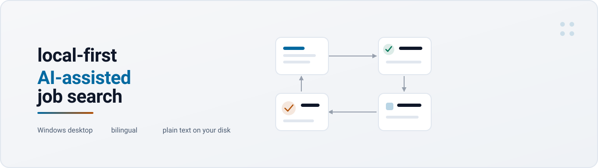
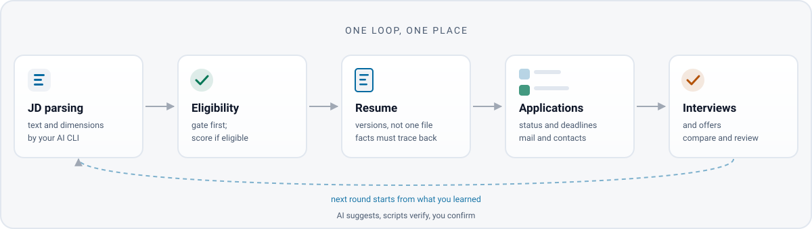
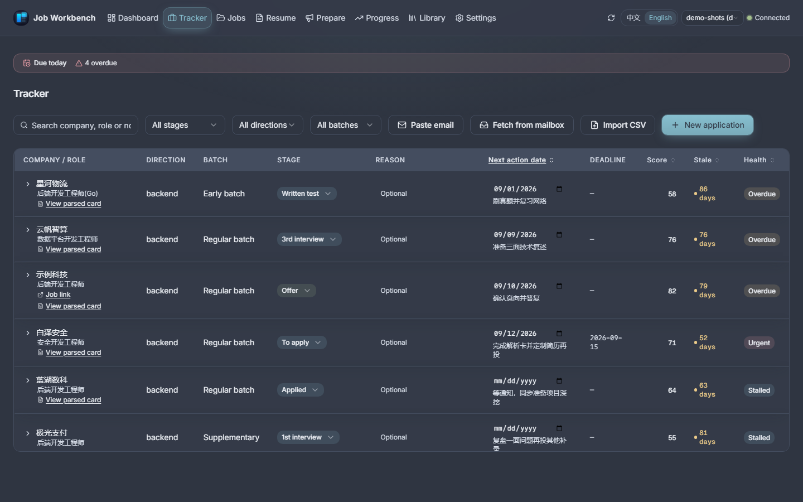
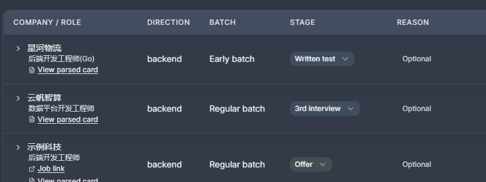
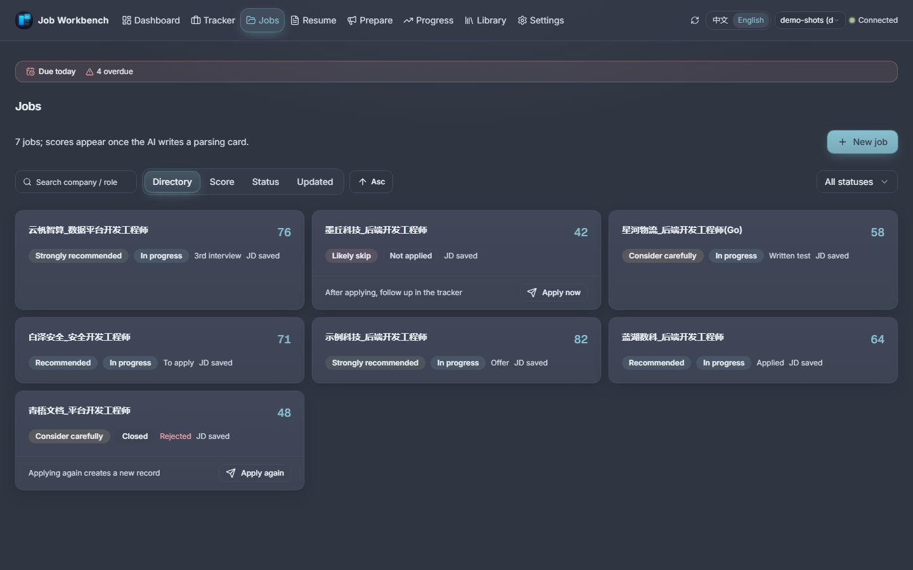
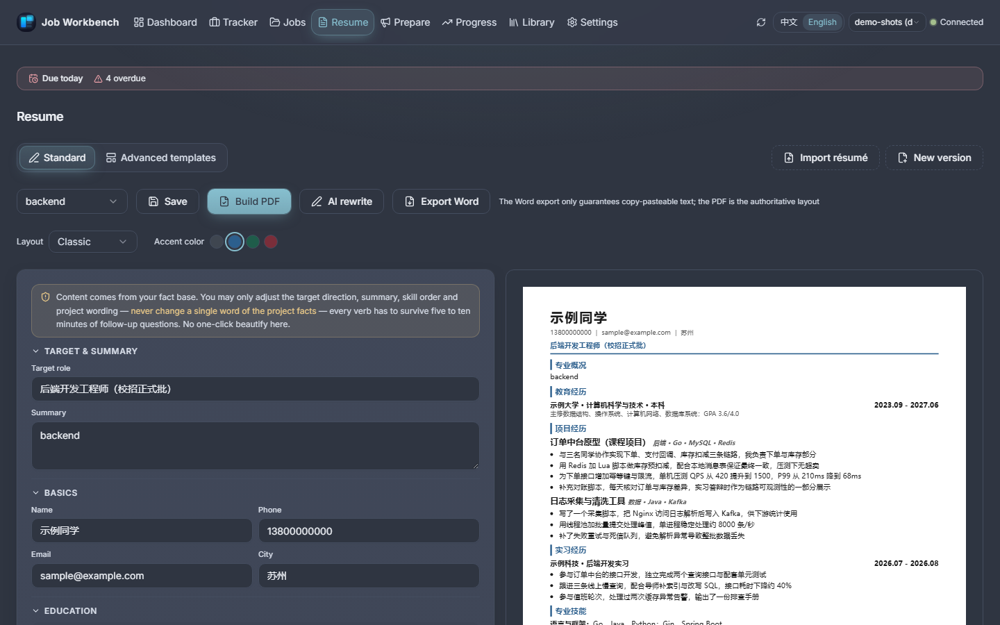
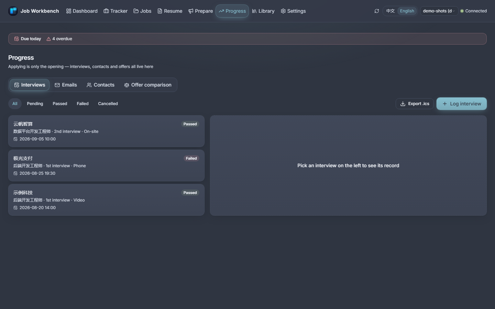

<div align="center">

# job-workbench



[](https://github.com/chenxiang6663635/job-workbench/actions/workflows/ci.yml)
[](https://github.com/chenxiang6663635/job-workbench/releases/latest)

[](LICENSE)

A **local-first career-action workbench built around auditable AI output**, currently focused on the job-search pipeline: from JD analysis to offer review. Data lives in plain Markdown & CSV on your own disk; four entry points drive the same data — **desktop app (with its browser UI), CLI, your own AI host (MCP), and editor plugins** — with matching wording and confirmation semantics (per-entry matrix: [`docs/four-ends.md`](docs/four-ends.md)).

[Download for Windows](https://github.com/chenxiang6663635/job-workbench/releases/latest) · [Screenshots](docs/screenshots.md) · [Documentation](docs/usage-guide.md)

English | [简体中文](README.zh-CN.md)

</div>

**The loop** — JD parsing → eligibility gate → resume versions → application tracking → interviews and offers. The gate runs before any scoring and can end the evaluation right there (fail, or "awaiting profile facts" — neither is scored); only an eligible job goes on to be scored. The readable version of that flow is this line;
the diagram itself lives under **Core design** further down.

## Five ways to use it

One local data base, several native entry points. All of them read and write the same
Markdown/CSV workspace on your disk. There is no vendor-hosted cloud service and no
telemetry: the desktop app starts a local backend bound to `127.0.0.1`, and an AI host only
sees what a tool call returns or what you paste into the conversation — nothing is uploaded
in the background.

| Entry point | What it is | Start here |
|---|---|---|
| **Desktop / Web** | The full UI — dashboard, jobs, resumes, applications, interviews, offers | [Download for Windows](https://github.com/chenxiang6663635/job-workbench/releases/latest) · [Screenshots](docs/screenshots.md) |
| **CLI** | Scriptable commands for every deterministic step: eligibility, scoring, PDF, tracking, diagnostics | [Usage guide](docs/usage-guide.md) |
| **MCP hosts** | `jobws-mcp` exposes **17 tools** — 9 read-only, 7 two-phase previews, 1 confirmed write (`apply_approval`) | [MCP integration](docs/mcp-integration.md) |
| **DeepSeek Harness** | Plugin bundle: the same 17 tools + **9 `jwb-*` skills** + an optional agent preset | [`integrations/dsh`](integrations/dsh/README.md) |
| **Editor plugins** | The same skills as slash commands inside CodeBuddy / Claude Code | [`skills/`](skills/) |

> **Every write is confirmed, on every entry point — the mechanism differs, the semantics
> don't.** No background edit can touch your data: the MCP tools force `preview_*` →
> `apply_approval`; the CLI previews the question bank by default, previews `track`
> add/update only when you pass `--preview`, is **always** two-phase for deletes, and writes
> contacts/offers directly — a command you typed is the confirmation; the UI asks in a
> dialog. Per-operation detail: [four-ends matrix](docs/four-ends.md).

### CLI in practice

```text
$ jobws doctor
数据根诊断（三态）：有歧义（ambiguous）——读可用，破坏性操作会被拒绝
- 数据根：D:\work\job-workbench
- 来源：legacy_portable；形态：source_form；可写：是
- 当前工作区：D:\work\job-workbench\personal（已建）
- 持久化选择：未设置
- 候选根：
    C:\Users\<you>\AppData\Roaming\job-workbench（含工作区）
    C:\Users\<you>\AppData\Roaming\job-workbench\data（无工作区）
    D:\work\job-workbench（含工作区）
提示：本机有多个候选根含工作区——破坏性操作会在确认目标根之前被拒绝。
```

This is a real `<code>jobws doctor</code>` run, with local paths replaced by placeholders
(the CLI speaks Chinese today, so the sample is verbatim). It is the command to reach for
when you are unsure **which** data root a command would touch.

`ambiguous` is only **one** of the states it can report: a fresh install usually starts at
`uninitialized` ("no workspace yet — normal first run") and a settled machine reports `ok`;
`ambiguous` means several candidate roots already hold a workspace, so destructive commands
refuse until you pick one. Run it on your own machine to see which one you are in.

### DeepSeek Harness

The DSH plugin is a first-class entry point, not a shim over the desktop app: it runs the
same domain logic against the same workspace. It **does not need the Windows desktop app**
installed — but the bundled runtime currently ships for `win32-x64` only; see
[`integrations/dsh`](integrations/dsh/README.md) for what that means on other platforms.

> **Not on npm yet.** `dsh-job-workbench` publishes together with `v26.11.0`. Until then,
> install locally with `dsh plugin add link:<repo>\integrations\dsh`.
>
> Screenshots of a real DSH session are still being captured — this section deliberately
> carries none rather than showing a mock-up.

## Why job-workbench

Job hunting means sensitive personal data (resumes, phone numbers, employer history) — and AI outputs that can quietly fabricate facts. This project is built around four answers:

- **Local-first privacy.** Everything lives on your disk as plain text — git-diffable, Excel-friendly, no telemetry, and **no cloud server** (the desktop app starts a local backend that listens on 127.0.0.1 only). Where the data sits depends on how you run it: the **desktop app** keeps a fresh install under `%APPDATA%\job-workbench\data\` (or wherever `jobws data-root set` points it), while a **repo clone** uses the git-ignored `personal/` workspace. Either way the repository itself ships zero real data.
- **Auditable AI, not black-box automation.** Your own AI CLI (BYOK models) does the semantic judgment — reading the JD, scoring fit. Python scripts do everything deterministic: eligibility gates, score validation, PDF generation, tracker I/O — and every automated verdict (application health, CSV import diffs, failure clustering) comes with explicit, human-checkable **reasons**, never a bare score.
- **Anti-fabrication safeguards.** Resume import is *extraction, not generation*: every persisted value must trace back to source text, and unextracted fields are flagged. AI rewrite suggestions must pass five local anti-fabrication checks before they can be accepted.
- **One engine, any field.** The scoring rules are field-agnostic — the domain knowledge lives in **data-only profiles** (two ship in the box: HVAC & cooling, software backend), so any specialty works by authoring one per [`docs/domain-contract.md`](docs/domain-contract.md).

## What it solves

The real difficulty of job hunting is not "not knowing what to do" — it is **scattered information that blocks decisions**:

- Is this company worth applying to? What did I conclude about a similar one last week?
- Which resume version did I send them three months ago, and what did the JD ask for?
- How many applications are in flight, and which deadline is tomorrow?
- The email said "finish the assessment before the 25th" — will that deadline quietly slip?

The workbench turns all of that into queryable, traceable files.

### How it differs from the usual tools

| Approach | Typical use | Where Job Workbench differs |
|---|---|---|
| Excel / Notion templates | You build the job and application ledger yourself | Flexible, but keeping resume versions, JD evidence and progress linked is work you maintain |
| Job platforms | Search, apply, and watch status inside each platform | Progress lives per platform; one personal record across channels is not the point of the product |
| General AI chat | Analyse a JD, polish text, answer questions | Gives analysis, but does not keep it structured against your own local job data |
| **Job Workbench** | Organise jobs, resumes, applications, interviews and offers in one place | Plain files on your disk, evidence you can re-check, AI that suggests, and every key change confirmed by you |

## Core design

- **AI judges, scripts verify.** Scores come from your AI CLI reading the JD against your profile; Python only validates totals, applies thresholds, generates PDFs, reads/writes the tracker — and makes explainable deterministic calls (application health in four states, CSV import diffs, failure clustering — all with reasons). Changing scoring rules means editing Markdown profiles, not code.
- **Four-layer one-way dependency**: skills (domain knowledge) → scripts (IO & validation) → data (Markdown + CSV) → git (versions). The `tools/` tree is a layered package — one CLI entry point (`jobws`) plus domain modules and gate scripts; module dependencies stay acyclic (domain code never imports the web/protocol layer), so each module stays independently testable.
- **Three-layer separation**: tooling (`tools/` + `skills/`, domain-agnostic) · domain profiles (`template/profiles/`, pluggable) · user workspace (`personal/`, your real data). A three-tier lexicon judges skills by *"can you survive follow-up questions"*, not *"have you heard of it"* — see [`template/AGENTS.example.en-US.md`](template/AGENTS.example.en-US.md).



## Features at a glance

- **Four AI-assisted workflows**: `jwb-jd` (JD parsing & scoring), `jwb-apply` (application package), `jwb-track` (tracker & funnel), `jwb-resume` (PDF rebuild & validation) — driven by the in-repo `jobws` CLI; full command reference in the [usage guide](docs/usage-guide.md)
- **Web UI** (`web/`): eight pages sharing the very same data files — dashboard, tracker, job pool, resume workshop (one-click import that *extracts rather than generates* + guarded AI rewrite + Word export), prepare (talks & your question bank), progress (interviews, emails, contacts), library (notes & material), settings; see [`web/README.md`](web/README.md)
- **Post-application loop**: interview records (one-click `.ics` export), recruiter contact follow-ups, offer comparison (**side-by-side facts, never a recommendation**), resume version lineage, stage-conversion retros, failure clustering, application health in four states — each with concrete reasons instead of a black-box score
- **Read-only email fetch (optional)**: with your own IMAP authorization code, pull recent recruiting emails and turn them into per-record status suggestions; read-only, connected only when you click, credentials kept local, dry-run until you confirm — details in the [usage guide](docs/usage-guide.md)
- **Email ledger & honest deep links** (`mails.csv` + `jobws track mail`): interview invites, test notices and rejections become first-class records that link back to an application — pulled emails carry their Message-ID and can be filed with one click. "Open original" is graded honestly: your own pasted link wins; Gmail gets a real `rfc822msgid` search deep link; other providers (Outlook / QQ / 163 / …) get a "copy the subject and search" fallback instead of a fake link. **Emails never change stages by themselves** — you always confirm.
- **Resume layouts & accent colors**: three built-in layouts (Classic / Compact / Accent) share a single placeholder skeleton, all single-column and ATS-checked; four accent colors combine freely with any layout, and the generated PDF matches the preview. Drop your own compliant HTML into the templates directory and it appears in the picker.
- **Interface typography**: a continuous size slider (80%–150%, 5% steps — root-font scaling, decoupled from desktop zoom and available in a plain browser) and **12 bundled UI typefaces** (Inter by default, plus Geist, IBM Plex Sans, Manrope, Plus Jakarta Sans, DM Sans, Figtree, Outfit, Public Sans, Source Sans 3, Work Sans, Atkinson Hyperlegible Next), with two more that load no webfont at all — System UI and serif.
- **A separate monospace slot**: **6 families** for code, record IDs and timestamps (Maple Mono by default; JetBrains Mono, Fira Code, Geist Mono, IBM Plex Mono, Source Code Pro).
- **A third slot for numerals alone**: KPI figures, counts, days and percentages take their own font (Geist Mono by default, or JetBrains Mono / IBM Plex Mono / follow the UI typeface) — deliberately paired to sit beside any UI typeface. Every face is bundled locally under OFL-1.1, Latin subsets only; CJK falls back to the system stack.
- **Scoring framework**: an eligibility gate first (degree → major → cohort → language → city; unfilled profile facts yield "awaiting profile facts" instead of a fail — fill them and re-run; city *preferences* only deduct from growth, hard infeasibility still vetoes). **A job that fails the gate is not scored at all** — only an eligible one goes on to four weighted dimensions → five-tier verdict; the full standard lives in [`skills/jwb-recruit-coach/SKILL.md`](skills/jwb-recruit-coach/SKILL.md)
- **Domain profiles are data, not code**: two ship in the box (HVAC & cooling — 6 directions; software backend — the minimal reference example). Your own field works by authoring a profile per [`docs/domain-contract.md`](docs/domain-contract.md) — pure data, two full examples to copy, validated by `jobws lint domains`.

## UI Preview

Four of the eight pages. The [screenshot gallery](docs/screenshots.md) has all of them, one per page, each with a line on what it is for — and the same set in 简体中文.

### 1. Application tracker

Track applications, deadlines and next steps.



*Close-up — stage, deadline and score readable without zooming:*



[View full size](docs/screenshots/02-applications.png)

### 2. Job pool and eligibility

Check eligibility **before** a job is scored.



[View full size](docs/screenshots/03-jobs.png)

### 3. Resume workshop

Import, verify, and prepare resume versions.



[View full size](docs/screenshots/04-resume.png)

### 4. Interviews and offers

Follow up after applying, and compare offers side by side.



[View full size](docs/screenshots/06-progress.png)

> **Note**: the interface is **bilingual** — every page ships in 简体中文 and English, with a `中文 / English` switch in the header (first run follows your system language, and the choice is remembered). The code, this README and the [usage guide](docs/usage-guide.md) are in English — with one deliberate exception: **code comments are Chinese by convention** (see [contributing.en-US.md](docs/contributing.en-US.md) §Copy & i18n). What stays Chinese **by design**: the values stored in your CSV / Markdown files (stage names, column headers) — they are the shared data contract with the CLI and with your own history, so translating them would desync the UI from your data — plus the CLI's built-in help.

All screenshots run on generated demo data (`jobws init --target demo --demo`); companies, roles and names are placeholders (`示例科技`, `示例同学`, …) — no real personal information. Both language sets are produced by `npm.cmd run capture` in `web/frontend` — rerun it after any page change instead of retaking shots by hand.

## Download

A packaged Windows desktop app (no Python/Node needed) is attached to the
latest release — grab `job-workbench-setup-*.exe` from
[Releases](https://github.com/chenxiang6663635/job-workbench/releases/latest),
install, launch, done. The installer is a wizard: pick the install folder and
whether to install for all users or just you (when upgrading, keep the
defaults). Data lives in `%APPDATA%\job-workbench\data\` (the default for a
fresh install — an existing workspace stays exactly where it is) and stays local — no
project-run server, no telemetry. Networking happens only through the features
you enable, plus one startup update check — details in the
[data-flow matrix](docs/data-flow-matrix.md). Prefer source? Skip to
[Quick start](#quick-start).

Version numbers are month-granularity CalVer `YY.MM.N` (`26.9.0` = first
release of the month; a hotfix bumps `N`).

**The installer is not code-signed yet.** On first run Windows may show
"Windows protected your PC" (SmartScreen) — that is expected for unsigned
software: click **More info** → **Run anyway**. SmartScreen reputation builds
per release, so the notice may reappear on later versions. Starting with
v26.9.0, each release attaches `SHA256SUMS.txt` (hashes for the installer and
`latest.yml`) — you can
verify your download against it. Auto-update is unaffected by the missing
signature — integrity is checked against the hash in `latest.yml` — and the
whole chain was **verified end-to-end on a real machine (2026-10-30)** against
the public release: 26.10.0 found 26.10.1, downloaded the delta (131 MB → 6.4 MB),
installed, restarted, and the workspace data was intact. The update still asks
for your two confirmations (`autoDownload` is off). Evidence:
[release checklist](docs/release-checklist.md) §〇.

## Quick start

```bash
# 0. Just want to look around first? One command gives you a filled demo workspace
#    (8 applications / 3 interviews / 2 contacts / 1 offer / 3 talks & job fairs
#     / 6 question-bank items / 6 emails / 7 parsed JD cards / 1 resume,
#     all placeholder data)
python tools/jobws.py init --target demo --demo

# 1. Initialize a workspace (six modules + profile templates + a domain plugin)
#    Swap --domain for your own field — see the "Domain profiles" table in docs/README.en-US.md
#    ("personal" is the CLI's default workspace name; any directory name works.)
python tools/jobws.py init --target personal --domain hvac-cooling

# 2. Distribute skills / commands / subagents to your AI CLI
#    (CodeBuddy / Claude Code / cross-runtime ~/.agents/skills/)
python tools/jobws.py skills install --target user

# 3. Fill in personal/AGENTS.md
#    Section 3 (hard eligibility facts) is required — unfilled fields put a job
#    into "awaiting profile facts" (not scored, not killed) until you fill them;
#    the gate never guesses. The file also carries two honesty red lines:
#    every resume verb must survive questioning; never fabricate experience.
#    Not a Chinese reader? template/AGENTS.example.en-US.md is the English
#    version — use its content for AGENTS.md.
```

**Rather not clone the repo?** Three channels:

- **Plugin marketplace (recommended — skills, commands and subagents together)** — with CodeBuddy or Claude Code, add this repo as a marketplace and install it (the plugin reads `skills/`, `commands/` and `agents/` straight from the repo; there is no second copy):

```
/plugin marketplace add https://github.com/chenxiang6663635/job-workbench
/plugin install job-workbench
```

- **Skills only**: `npx skills add chenxiang6663635/job-workbench` (installs into the current directory; `-g` for the user level — `.agents/skills/` is the cross-host convention, Claude Code reads `.claude/skills/`).

- **DeepSeek Harness (DSH)**: the same workbench as one installable plugin bundle — MCP tools, the nine skills and an optional `jobws` preset in a single package **not on npm yet** — it ships together with v26.11.0, so until then install it from a checkout with `dsh plugin --profile <p> add link:<repo>\integrations\dsh`; the published form is `dsh plugin --profile <p> add dsh-job-workbench`, and the known boundaries live in [`integrations/dsh/README.md`](integrations/dsh/README.md).

The local script covers custom layouts and acts as the fallback: `python tools/jobws.py skills install` distributes all three asset types by each host's directory convention (skills → skills dirs; commands and subagents → `.codebuddy/`, `.claude/`), copying by default. `--link` is experimental and symlinks the host copies to the single source instead (no stale copies; on Windows it needs developer mode or admin). **In-repo project-level copies** are kept honest by `python tools/jobws.py lint four-ends` — stale or diverged copies are named, and skills additionally report extra directories (your own files under `.claude/` are not counted). User-level `~/.agents/skills/` and plugin-marketplace caches are outside the checker's view: they do not travel with the repo.

Then just talk to your AI CLI: "parse this JD", "apply to this role", "what needs attention this week".

Requirements — CLI: Python 3.12+ (standard library only); `pypdf` for PDF validation; `certifi` ships the fallback CA bundle used when your system certificate store is unusable (outbound HTTPS / IMAP). PDF generation: Chrome or Edge. Web UI (optional): see [`web/README.md`](web/README.md).

## Referral

The optional AI features (resume import, AI rewrite) are BYOK — bring a key from any OpenAI-compatible provider. If you do not have one yet, the Settings page offers [OrcaRouter](https://www.orcarouter.ai/ref/ref_f34ad879f774bce8bc82) as a preset optional provider. Full disclosure: this is a **referral link** — signing up through it earns the project author a commission; your pricing and benefits are unaffected, and clicking it only opens a web page (nothing is sent from the app by clicking).

## Privacy

This repository contains **no real personal data**. `personal/` is a workspace you fill with your own data (name, photo, contacts, applications, fact cards); it is entirely excluded from version control — after cloning, it is empty; generate your own with the init command above. That keeps the **repository** clean, and it is what makes a public fork safe. It does not cover everything outside the repo: exported diagnostics bundles, logs you paste, and screenshots of your own workspace are yours to check. **Never paste `personal/` content into issues, PRs or discussions.**

## Repository layout

| Path | Purpose |
|---|---|
| `template/` | Generic skeleton: profile templates, empty workspace, domain plugins |
| `skills/` | Nine skills — five job-hunting workflows (JD / apply / track / resume / coach), one setup/extension skill (domain profiles), and three maintainer-facing skills (CLI contract / API review / MCP) — single source across AI runtimes |
| `tools/` | Python domain layer — one CLI entry point plus domain modules and gate scripts |
| `web/` | Web UI: FastAPI backend + React frontend (eight pages), same data files as the CLI |
| `site/` | Project site (documentation site): assembler, config, page content and build |
| `tests/` | pytest suite — privacy guards, anti-fabrication checks, tracker semantics; the CI gate |
| `personal/` | Your real workspace (**fully git-ignored; the repo ships zero real data**) |
| `docs/` | Usage guide, doc index, design documents (`docs/specs/`) |
| `.github/` | CI workflow, issue / PR templates, code of conduct, Copilot instructions |
| `.codebuddy-plugin/` | CodeBuddy plugin manifest — delivers the same `skills/` plus the commands and subagents; no second copy |
| `integrations/dsh/` | **DeepSeek Harness surface** — the npm package `dsh-job-workbench`: the MCP hookup, the nine skills and an optional preset, bundled into one installable package (**not on npm yet** — first publish rides with v26.11.0; until then install it from a checkout with `link:`). That folder's README is the source of truth for install / upgrade / rollback |
| `docs/four-ends.md` | **Four-entry capability matrix** (CLI / AI host / editor plugin / desktop UI), generated from `tools/four_ends_matrix.json` and checked by `jobws lint four-ends`. See `docs/mcp-integration.md` to plug the workbench into an AI host — the config key differs per host |

## Docs

- [Online docs site](https://chenxiang6663635.github.io/job-workbench/) — project intro, usage guide and downloads as a website (bilingual, searchable). The site is GitHub-hosted: if GitHub is unreachable from your network, the [Gitee mirror](https://gitee.com/Chenxiang663635/job-workbench) carries the repository — docs sources render as Markdown there, and its Issues are the mainland-reachable feedback channel
- [Roadmap](ROADMAP.md) — Now / Later plus a shipped-batch log; items link to a tracking issue when one exists
- [Doc index](docs/README.en-US.md) — status of every document (current / deprecated)
- [Usage guide](docs/usage-guide.md) — startup, the eight pages, AI workflows, CLI reference, FAQ
- [Support & compatibility](docs/support-and-compatibility.md) — when this counts as a stable release, what is supported, and why upgrades never require converting your data
- [Screenshot gallery](docs/screenshots.md) — every page of the UI, one per section (简体中文: [screenshots.zh-CN.md](docs/screenshots.zh-CN.md))
- [Design documents](docs/specs/) — architecture, Web contract, productization, open-source release
- [Changelog](CHANGELOG.md)
- [Glossary](docs/glossary.en-US.md) — the internal terms used across these docs and the changelog, defined once (terms stay Chinese; the English companion explains them)

## Contributing

Issues and PRs are welcome — bug fixes, documentation, new domain profiles, privacy safeguards, tests and interoperability improvements are particularly useful. Please read [CONTRIBUTING.md](CONTRIBUTING.md) first (the four-gate process for new features, branching strategy, release flow) and the [code of conduct](.github/CODE_OF_CONDUCT.md). **Found a security problem? Use the private channel described in [SECURITY.md](SECURITY.md) — please do not open a public issue.** **All changes go through a PR with green CI** (pytest + frontend lint/build + PR-title check + UI smoke) — `main` has branch protection, so that includes documentation-only edits (see [contributing.en-US.md](docs/contributing.en-US.md) §Branching strategy). **Pace expectation**: a single-maintainer project — work arrives in bursts: some days land a focused batch of small PRs, other weeks land none (no development during interview/exam weeks — see [contributing.en-US.md](docs/contributing.en-US.md) §Sustainability). First response to issues targets 48 hours, with slips disclosed in a pinned issue (see [docs/maintenance.md](docs/maintenance.md)); a few days without a reply can still happen.

## License

[MIT](LICENSE) © job-workbench contributors — third-party notices in [THIRD-PARTY-NOTICES.md](THIRD-PARTY-NOTICES.md).
