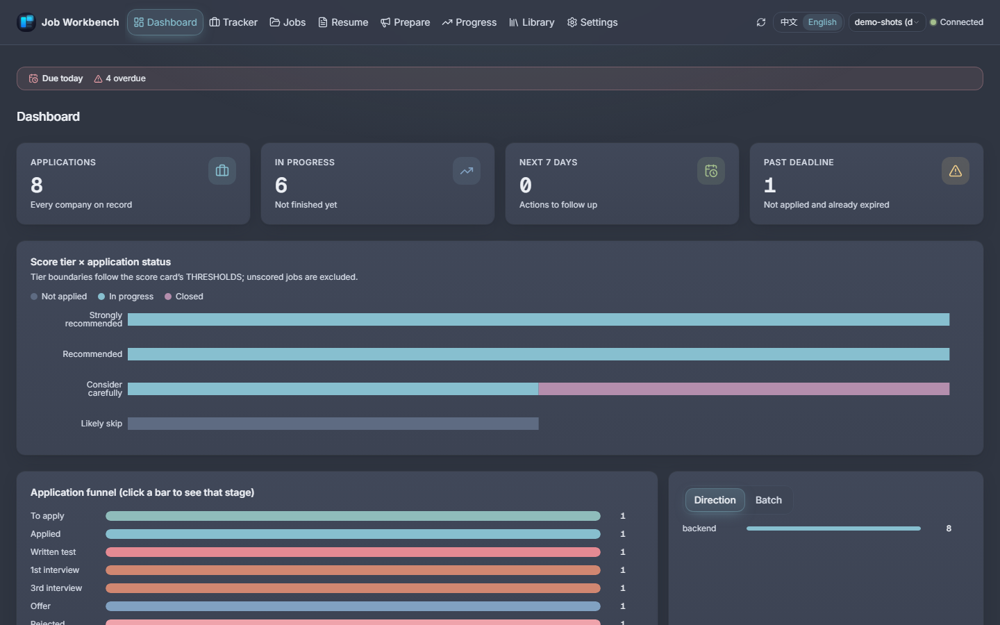
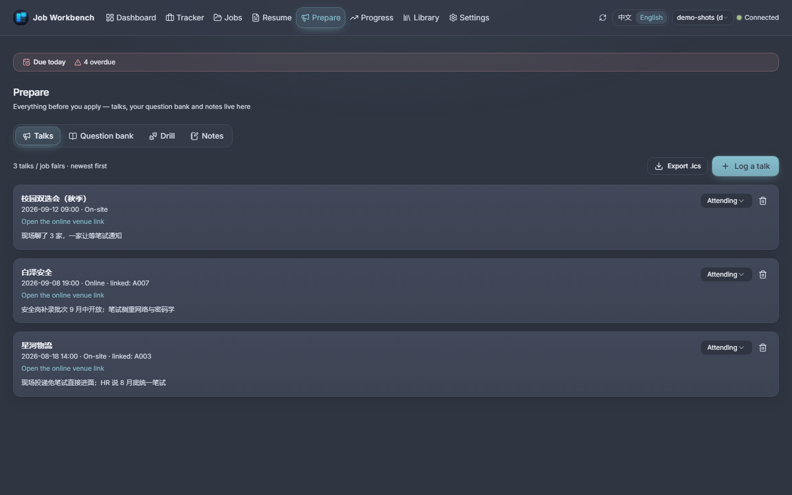
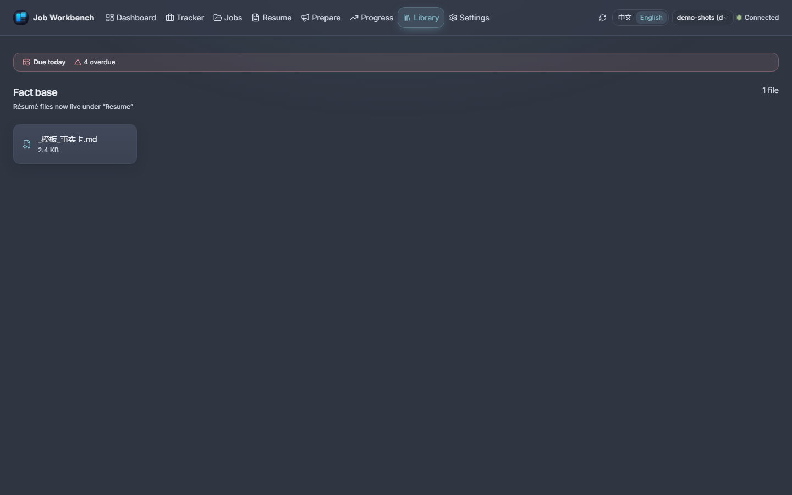
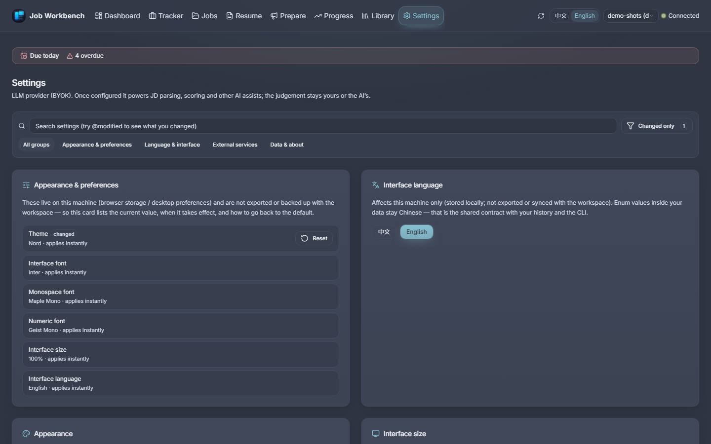

# Screenshot gallery

Every page of the desktop UI (and its browser UI — same build, same data), captured
from the generated demo workspace. The [README](../README.md) shows three of them;
this page carries the full set.

> **Note**: the interface is **bilingual** — every page ships in 简体中文 and English,
> with a `中文 / English` switch in the header (first run follows your system language,
> and the choice is remembered). The code, the README and the [usage guide](usage-guide.md)
> are in English — with one deliberate exception: **code comments are Chinese by convention**
> (see [contributing.en-US.md](contributing.en-US.md) §Copy & i18n). What stays Chinese
> **by design**: the values stored in your CSV / Markdown files (stage names, column headers) —
> they are the shared data contract with the CLI and with your own history, so translating
> them would desync the UI from your data — plus the CLI's built-in help.

All pages run on generated demo data (`jobws init --target demo --demo`); companies,
roles and names are placeholders (`示例科技`, `示例同学`, …) — no real personal information.
Both language sets are produced by `npm.cmd run capture` in `web/frontend` — rerun it after
any page change instead of retaking shots by hand.

> **These shots are from 2026-09-30** (`69f53e6`), the last time the capture ran. The UI has
> moved since — the top bar became its own zone, and the Library page gained note back-stack
> navigation (`2325835`). A re-capture is registered in the [roadmap](../ROADMAP.md) §Now;
> until it lands, treat the layout details here as slightly older than the app you install.

The same pages in 简体中文: [`screenshots.zh-CN.md`](screenshots.zh-CN.md).

## Dashboard

What needs attention today: deadlines, reminders, the funnel at a glance.

## Tracker

Every application with its stage, health (four states, each with reasons) and next step.

## Job pool

Parsed JD cards: the AI's scored judgment, the eligibility gate's verdict, and the JD text it came from.

## Resume workshop

Import *extracts* rather than generates; three ATS-checked layouts, four accent colors, Word export.

## Prepare

Talks and job fairs, plus your question bank — expression first, knowledge after.

## Progress

Interviews, emails, contacts and offers, each linked back to the application it belongs to.

## Library

Notes and material, cross-linked to the records they support.

## Settings

Theme, typography (three independent slots), language, data root, AI provider.
