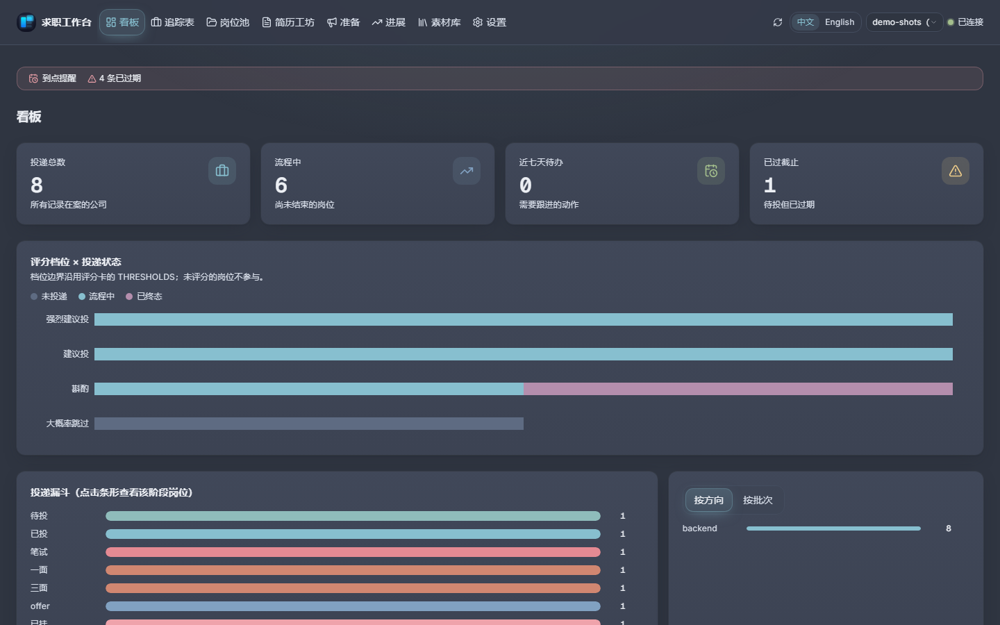
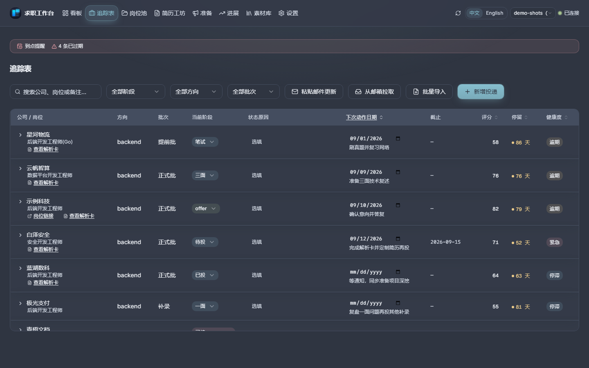
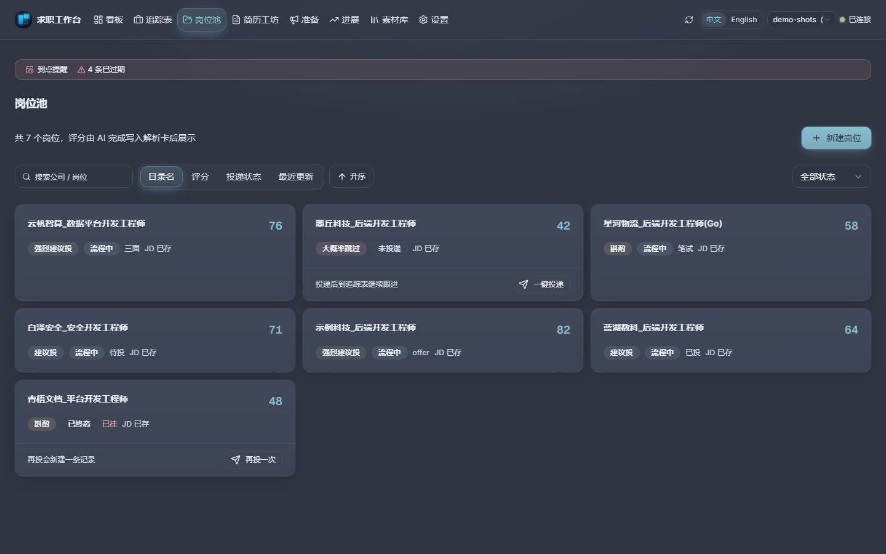
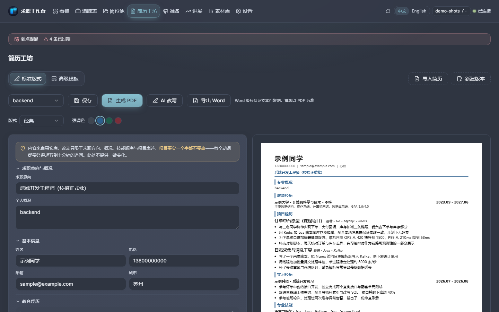
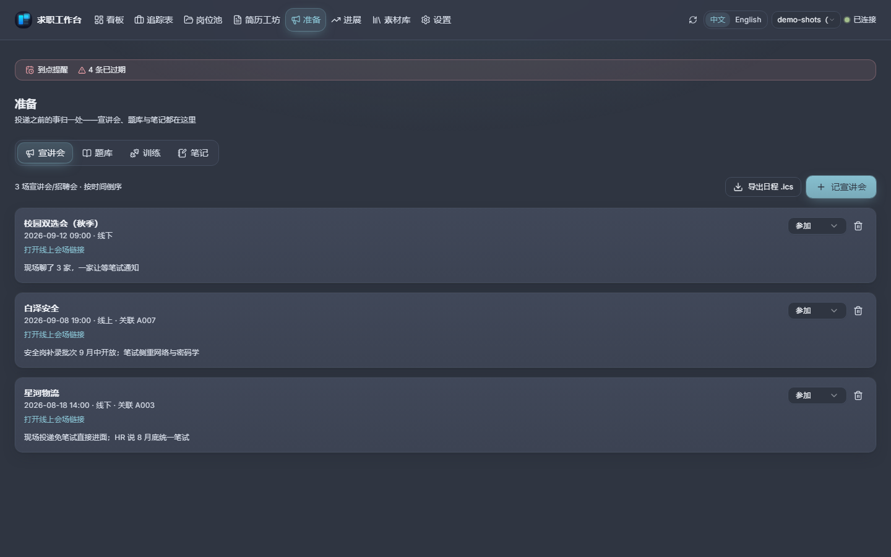
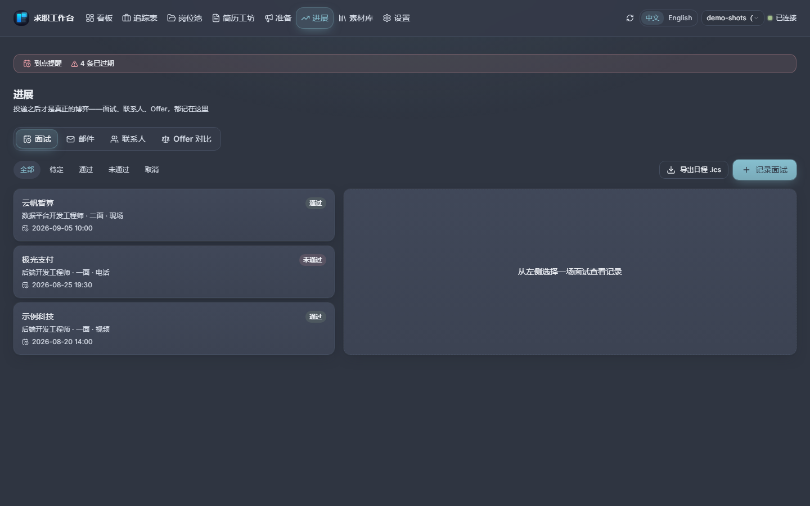
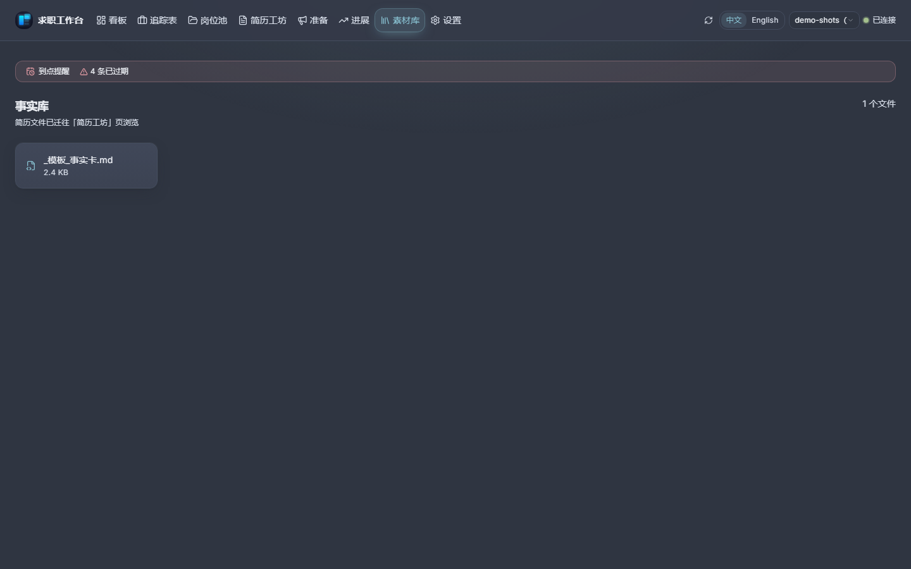
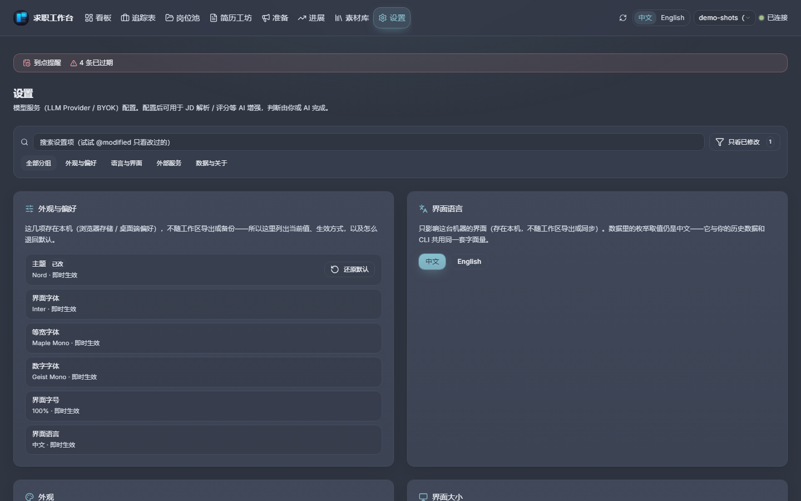

# 界面截图图库

桌面端界面（以及它的浏览器界面——同一份构建、同一份数据）的全部页面，取自自动生成的
demo 工作区。[README](../README.zh-CN.md) 只放三张，完整的一套在这里。

> **说明**：界面**中英双语**——每一页都有中文与英文，顶栏的 `中文 / English` 可随时切换
> （首次按系统语言，选择会被记住）。本页与[使用手册](usage-guide.zh-CN.md)是中文，英文版见
> [`screenshots.md`](screenshots.md) 与 [usage-guide.md](usage-guide.md)；**代码注释按本项目惯例
> 用中文**（见 [contributing.zh-CN.md](contributing.zh-CN.md)）。有意保留中文的还有：你自己录进
> 工作区的内容，以及 CSV / Markdown 里存的枚举取值（与 CLI 共享的数据契约，翻译了会让界面与你的
> 历史数据脱节）；CLI 自带帮助同理。

以下页面全部由 demo 数据生成（`jobws init --target demo --demo`），公司、岗位、人名均为占位
（`示例科技`、`示例同学` 等），不含任何真实信息。中英两套图都由 `web/frontend` 下的
`npm.cmd run capture` 产出——页面改了就重跑它，不要手工重拍。

> **这批图摄于 2026-10-30**，用 **Nord** 主题捕获。截图脚本跑在 `dist` 上，且会拒绝
> 拍旧构建（会以「dist 比 src 旧」退出），所以这里反映的是今天的界面——含数据根那一批：
> 设置页的位置卡片、迁移流程与修复面板。重拍：`npm run capture -- --theme nord`。

英文的那一套：[README.md](../README.md) 的「UI Preview」节与 [`screenshots.md`](screenshots.md)。

## 看板

今天要处理什么：截止日、提醒、漏斗一眼看完。

## 追踪表

每条投递的阶段、健康度（四态，各带理由）与下一步。

## 岗位池

解析卡：AI 的评分判断、资格门槛的结论，以及结论所依据的 JD 原文。

## 简历工坊

导入是**抽取而非生成**；三套过 ATS 校验的版式、四档强调色、可导出 Word。

## 准备

宣讲会与招聘会，加上你自己的题库——先有表达，再补知识。

## 进展

面试、邮件、联系人与 Offer，每条都指回它所属的投递记录。

## 素材库

笔记与素材，互相链接到它们支撑的记录。

## 设置

主题、排版（三个独立槽位）、语言、数据根、AI 服务商。